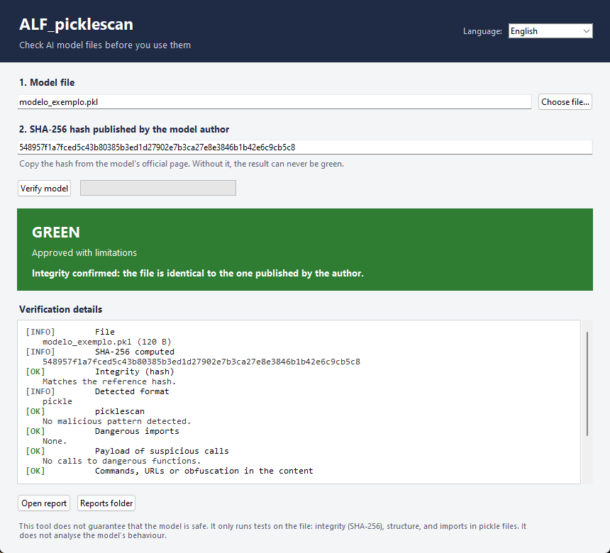

# ALF_picklescan

**Vérificateur gratuit et open source de fichiers de modèles d'IA.** Avant de charger un modèle que vous avez téléchargé, vérifiez son intégrité, sa structure et s'il cache du code dangereux. Compatible avec les fichiers **GGUF**, **safetensors** et **pickle/PyTorch** (`.bin`, `.pt`, `.pth`, `.pkl`). Windows et Linux. Aucune installation, aucune connaissance en programmation nécessaire.

> ⚠️ **Cet outil ne garantit pas que le modèle est sûr.** Il effectue seulement des tests sur le fichier : intégrité (SHA-256), structure et imports des fichiers pickle. Il n'analyse pas le comportement du modèle, et un modèle entraîné pour un déclencheur caché peut réussir tous les tests. C'est un premier filtre, jamais une garantie de sécurité. Voir les [Limites](#limites).

Disponible en : [English](README.md) · [Português (PT)](README.pt-PT.md) · **Français** · [Español](README.es.md) · [Italiano](README.it.md) · [中文](README.zh.md) — l'interface de l'application est disponible dans les six langues.



---

## Pourquoi ce projet existe

N'importe qui peut publier un modèle sur une plateforme publique, et n'importe qui peut le télécharger. Les fichiers de modèles ne sont pas des données inertes : un **pickle** (utilisé par la plupart des checkpoints PyTorch, `.bin`, `.pt`, `.pth`) peut exécuter du code au moment où vous le chargez. Un fichier correct au moment de sa publication peut être remplacé plus tard, et un téléchargement peut arriver corrompu ou modifié.

Les personnes qui font tourner des modèles en local n'ont, en pratique, aucun moyen de répondre à une question simple : *ce fichier est-il celui publié par l'auteur, et contient-il quelque chose de manifestement hostile ?* Elles installent le modèle et espèrent que tout se passe bien.

Les scanners privés et les plateformes payantes répondent à cette question pour les entreprises. Ce projet y répond pour tous les autres : étudiants, chercheurs, petites équipes, curieux sur un ordinateur portable. **La sécurité de base ne devrait pas être un service payant.** ALF_picklescan est gratuit, sous licence MIT, sans compte, sans télémétrie, sans serveur et sans limite. Il est fait pour être copié, amélioré et redonné.

L'auteur ne vend rien, ne collecte aucune donnée et ne demande pas de dons. L'objectif est que davantage de personnes vérifient ce qu'elles téléchargent, et que moins de machines soient compromises par un fichier que personne n'a regardé.

## Ce qu'il fait

- Calcule le **SHA-256** du fichier et le compare à l'empreinte publiée par l'auteur du modèle.
- Valide la **structure** des fichiers GGUF, safetensors et ZIP PyTorch.
- Lit les **imports** des fichiers pickle **sans les exécuter** (même technique que [picklescan](https://github.com/mmaitre314/picklescan)) et signale les fonctions dangereuses connues, comme `os.system`, `subprocess`, `eval` ou `exec`.
- Montre **ce que l'appel suspect exécuterait** : la commande, l'URL ou le bloc encodé transporté dans le pickle, affiché comme preuve, ainsi que les motifs de shell, téléchargement, vol d'identifiants, persistance et obfuscation. Rien n'est exécuté.
- Signale les **fichiers exécutables** cachés dans un paquet de modèle.
- Affiche un **verdict en feux tricolores** et crée un **rapport HTML** que vous pouvez conserver ou partager.
- Affiche le **nom et le détail de chaque vérification dans la langue choisie** (anglais, portugais, français, espagnol, italien ou chinois), rapport compris.

L'analyse est en lecture seule. L'outil ne charge, n'importe et n'exécute jamais le modèle.

## Téléchargement

Allez sur la page [**Releases**](https://github.com/antonioferreira2/ALF_PickleScan/releases) et choisissez le fichier correspondant à votre système. Les versions Windows et Linux sont publiées séparément.

| Système | Fichier | Configuration requise |
|---|---|---|
| **Windows 10 / 11** (64 bits) | `ALF_picklescan-windows-x64.exe` | Aucune. Double-clic. Compilé avec Python 3.11 sur Windows Server 2022. |
| **Linux** (x86-64) | `ALF_picklescan-linux-x86_64` | glibc **2.35** ou plus récent — Ubuntu 22.04+, Debian 12+, Fedora 36+, Linux Mint 21+. Compilé sur Ubuntu 22.04. |

Chaque fichier est accompagné d'un `.sha256`. **Vérifiez-le avant d'exécuter le fichier.**

**Windows** (Invite de commandes ou PowerShell) :
```
certutil -hashfile ALF_picklescan-windows-x64.exe SHA256
```

**Linux :**
```
sha256sum -c ALF_picklescan-linux-x86_64.sha256
chmod +x ALF_picklescan-linux-x86_64
./ALF_picklescan-linux-x86_64
```

Si Windows SmartScreen indique que l'application n'est pas reconnue, cliquez sur **Informations complémentaires → Exécuter quand même**. Cet avertissement apparaît parce que l'exécutable n'est pas signé numériquement ; un certificat de signature coûte de l'argent chaque année et ce projet est gratuit. Vérifiez toujours l'empreinte et comparez-la à celle publiée sur la page de la version.

Autres plateformes : le code source fonctionne partout où Python et Tk sont disponibles (macOS inclus). Voir [CONTRIBUTING.md](CONTRIBUTING.md) pour l'exécuter depuis les sources.

## Comment l'utiliser

1. Ouvrez l'application et choisissez votre langue dans le coin supérieur droit.
2. Cliquez sur **Choose file** (Choisir un fichier) et sélectionnez le modèle.
3. Collez le **SHA-256 publié par l'auteur** (fortement recommandé — cherchez-le sur la page officielle du modèle).
4. Cliquez sur **Verify model** (Vérifier le modèle).
5. Lisez le verdict. Cliquez sur **Open report** (Ouvrir le rapport) pour tous les détails.

Le rapport est enregistré à côté du programme, dans `ALF_relatorios/`.

Ligne de commande (Linux ou Windows, avec Python installé) :

```
python ALF_picklescan.py model.gguf --sha256 <hash>
```

Les codes de sortie facilitent l'usage dans des scripts et des pipelines CI : `0` vert, `1` jaune, `2` rouge, `3` erreur.

## Verdicts

| Couleur | Signification | Que faire |
|---|---|---|
| 🟢 **VERT** — approuvé avec limitations | Empreinte confirmée, aucune alerte | Vous pouvez l'utiliser, en respectant les limites |
| 🟡 **JAUNE** — revue manuelle | Pas d'empreinte de référence, imports hors de la liste blanche, texte suspect ou analyse incomplète | Examinez les détails avant d'utiliser |
| 🔴 **ROUGE** — ne pas utiliser | Empreinte différente, maliciel détecté, imports dangereux ou structure invalide | N'utilisez pas ce fichier |

Un résultat vert n'est **jamais** affiché sans une empreinte de référence confirmée.

## Limites

- **Pas une garantie de sécurité.** Un modèle malveillant entraîné à mal se comporter seulement sous un déclencheur précis peut réussir tous les tests.
- **Aucune analyse du comportement.** L'outil vérifie le fichier, pas ce que fait le modèle quand il s'exécute.
- **L'analyse des pickles utilise une liste de fonctions dangereuses connues.** Une charge utile nouvelle, absente de la liste, peut passer. Les appels sans import identifiable sont marqués en jaune pour cette raison.
- **Faire confiance à l'empreinte.** L'empreinte prouve que le fichier correspond à ce qui a été publié, pas que l'auteur est digne de confiance.
- **GGUF et safetensors ne sont validés que structurellement.** Cela confirme que le fichier est bien formé, pas que les poids sont bons ou honnêtes.

Pour les modèles utilisés avec des outils ou ayant accès à des données (agents, assistants locaux avec accès aux fichiers), **exécutez-les isolés** : un conteneur ou une machine virtuelle sans réseau et sans identifiants.

## Liste blanche d'imports

Au premier lancement, l'application crée `ALF_whitelist.txt` à côté du programme. Elle contient les imports considérés comme normaux dans les checkpoints PyTorch et NumPy. Si un modèle légitime est marqué en jaune uniquement à cause d'un import normal, vous pouvez l'ajouter après avoir vérifié qu'il est attendu pour ce modèle. Les contributions qui améliorent la liste par défaut pour d'autres architectures sont les bienvenues.

Si le dossier est en lecture seule, l'application utilise la liste intégrée et ne plante pas.

## Ce que contient ce dépôt

Seul le nécessaire pour utiliser, compiler et améliorer l'outil est publié ici :

| Chemin | Rôle |
|---|---|
| `ALF_picklescan.py` | Moteur de vérification et interface en ligne de commande |
| `ALF_picklescan_gui.py` | Interface graphique (Tk) |
| `i18n.py` | Traductions de l'interface (EN, PT, FR, ES, IT, ZH) |
| `build_exe.bat`, `build_linux.sh` | Compilations reproductibles pour Windows et Linux |
| `tests/test_smoke.py` | Tests automatisés avec des échantillons inoffensifs générés à la volée |
| `screenshots/` | Images utilisées dans la documentation |
| `README*.md`, `CONTRIBUTING.md`, `SECURITY.md`, `LICENSE` | Documentation et licence |
| `.github/workflows/` | Tests automatisés et compilation de la version pour les deux plateformes |

**Ne sont pas** dans le dépôt, volontairement :

- les **exécutables** — ils sont dans les [Releases](https://github.com/antonioferreira2/ALF_PickleScan/releases), pour qu'un nouveau clone reste léger et que l'historique ne se remplisse pas de binaires ;
- les résultats de compilation (`build/`, `dist/`, `*.spec`), les rapports générés (`ALF_relatorios/`) et le fichier local `ALF_whitelist.txt` ;
- les **fichiers de modèles** de toute sorte, et tout échantillon de test pouvant servir à attaquer quelqu'un ;
- les documents internes de préparation du lancement.

Pour compiler depuis les sources, lancez `build_exe.bat` sous Windows ou `./build_linux.sh` sous Linux. Les deux nécessitent Python 3.11 ou plus récent et produisent un exécutable unique qui inclut déjà picklescan.

## Feuille de route

Plan public. Les éléments peuvent changer ; l'avancement est suivi dans les [Issues](https://github.com/antonioferreira2/ALF_PickleScan/issues) et les [Discussions](https://github.com/antonioferreira2/ALF_PickleScan/discussions).

1. **v2.1 : interface multilingue et version Linux.** ✅ Anglais, portugais, français, espagnol, italien et chinois dans l'application ; versions Windows et Linux ; picklescan inclus dans les exécutables.
2. **v2.2 : preuves de charge utile.** ✅ Lorsqu'une fonction dangereuse est référencée, le rapport affiche les arguments qu'elle recevrait — la commande, l'URL, le bloc encodé — et signale les motifs de shell, téléchargement, vol d'identifiants, persistance et obfuscation.
3. **v2.3 : messages de vérification traduits.** ✅ Noms, détails et rapport suivent la langue choisie, dans les six langues.
4. **v3.0 : plus de formats et automatisation.** Prise en charge d'ONNX, export des rapports en JSON et mode de sortie pour les pipelines CI.

## Contribuer

Vous débutez ? Commencez par une **`good first issue`** : des tâches courtes et bien décrites pour une première contribution.

- Traduisez les messages de vérification du moteur (`ALF_picklescan.py`) pour que les rapports se lisent dans d'autres langues.
- Améliorez la liste blanche d'imports pour les architectures populaires (Llama, Mistral, Qwen, etc.), avec des exemples vérifiés.
- Ajoutez des tests automatisés avec des fichiers d'exemple inoffensifs.
- Relisez l'une des traductions du README si vous êtes locuteur natif.

Pour signaler un faux positif, ouvrez une issue avec le lien public du modèle, la version utilisée et la vérification signalée. N'envoyez pas de fichiers de modèles privés. Pour le processus complet, voir [CONTRIBUTING.md](CONTRIBUTING.md).

## Sécurité

Pour signaler une vulnérabilité, suivez [SECURITY.md](SECURITY.md). N'ouvrez pas d'issue publique pour un problème de sécurité.

## Auteur

Créé par **António Ferreira** (ALF), pour aider la communauté à utiliser les modèles d'IA avec un peu plus de sécurité. Ce n'est pas une vérification des faits sur un modèle et cela ne certifie rien : c'est seulement un test de base, et il peut se tromper.

Les améliorations, les forks et les meilleurs outils sont les bienvenus. Si vous pouvez faire quelque chose de mieux pour la société, faites-le.

## Licence

MIT. Voir [LICENSE](LICENSE). picklescan est également sous licence MIT.
