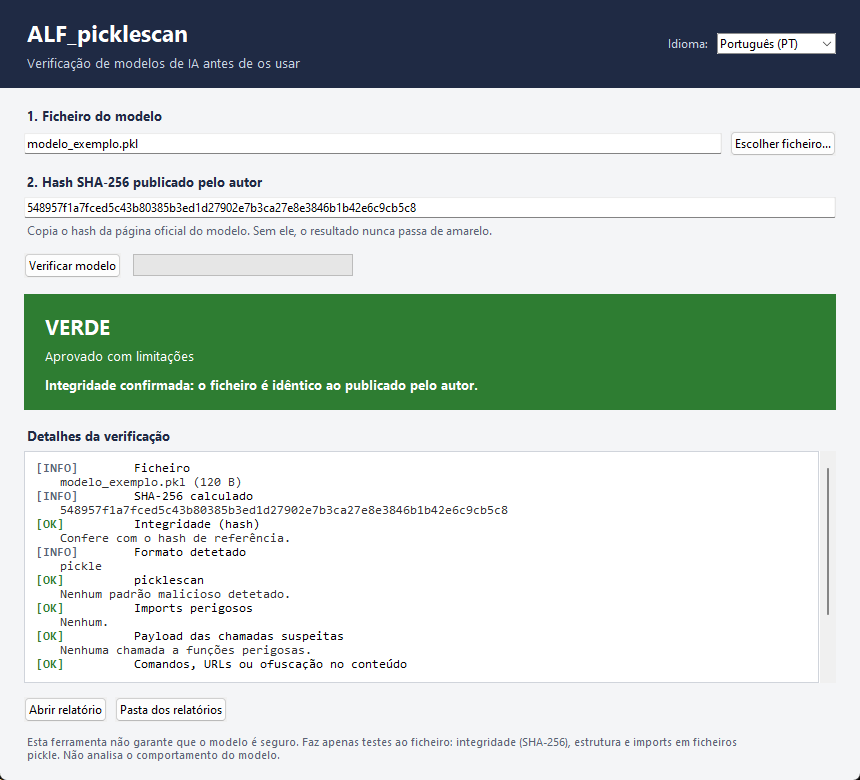

<p align="center"></p>

# ALF_picklescan

**Verificador gratuito e open source de ficheiros de modelos de IA.** Antes de carregares um modelo que descarregaste, verifica a integridade, a estrutura e se esconde código perigoso. Funciona com ficheiros **GGUF**, **safetensors** e **pickle/PyTorch** (`.bin`, `.pt`, `.pth`, `.pkl`). Windows e Linux. Sem instalação, sem precisares de saber programar.

> ⚠️ **Esta ferramenta não garante que o modelo é seguro.** Faz apenas testes ao ficheiro: integridade (SHA-256), estrutura e imports em ficheiros pickle. Não analisa o comportamento do modelo, e um modelo treinado para um gatilho escondido pode passar em todos os testes. É um primeiro filtro, nunca uma garantia de segurança. Vê as [Limitações](#limitações).

Disponível em: [English](README.md) · **Português (PT)** · [Français](README.fr.md) · [Español](README.es.md) · [Italiano](README.it.md) · [中文](README.zh.md) — a interface da aplicação está disponível nos seis idiomas.



---

## Porque existe este projeto

Qualquer pessoa pode publicar um modelo num repositório público, e qualquer pessoa o pode descarregar. Os ficheiros de modelos não são dados inertes: um **pickle** (usado na maioria dos checkpoints PyTorch, `.bin`, `.pt`, `.pth`) pode executar código no momento em que o carregas. Um ficheiro que estava correto quando foi publicado pode ser substituído mais tarde, e um download pode chegar corrompido ou adulterado.

Quem corre modelos localmente não tem, na prática, forma de responder a uma pergunta simples: *este ficheiro é o que o autor publicou, e contém algo obviamente hostil?* Instala o modelo e espera que corra bem.

Os scanners privados e as plataformas pagas respondem a isso para as empresas. Este projeto responde para todos os outros: estudantes, investigadores, equipas pequenas, curiosos com um portátil. **A segurança básica não devia ser um serviço pago.** O ALF_picklescan é gratuito, com licença MIT, sem conta, sem telemetria, sem servidor e sem limites. Foi feito para ser copiado, melhorado e partilhado outra vez.

O autor não está a vender nada, não recolhe dados e não pede donativos. O objetivo é que mais pessoas verifiquem o que descarregam, e que menos máquinas sejam comprometidas por um ficheiro que ninguém olhou.

## O que faz

- Calcula o **SHA-256** do ficheiro e compara-o com o hash publicado pelo autor do modelo.
- Valida a **estrutura** de ficheiros GGUF, safetensors e ZIP do PyTorch — incluindo os metadados GGUF e o respetivo **template de chat**, que o motor de inferência renderiza, e se cada tensor safetensors tem de facto o tamanho que a shape e o dtype exigem.
- Lê os **imports** dos ficheiros pickle **sem os executar** (com a mesma técnica do [picklescan](https://github.com/mmaitre314/picklescan)) e assinala funções perigosas conhecidas, como `os.system`, `subprocess`, `eval` ou `exec`.
- Mostra **o que a chamada suspeita receberia**: o comando, o URL ou o bloco codificado que vai dentro do pickle, apresentado como evidência, junto com padrões de shell, download, roubo de credenciais, persistência e ofuscação. Nada é executado.
- Assinala **ficheiros executáveis** escondidos dentro de um pacote de modelo.
- Mostra um **semáforo** e cria um **relatório HTML** que podes guardar ou partilhar.
- Apresenta o **nome e o detalhe de cada verificação no idioma que escolheres** (inglês, português, francês, espanhol, italiano ou chinês), incluindo o relatório.

A análise é só de leitura. A ferramenta nunca carrega, importa nem executa o modelo.

## Descarregar

Vai à página de [**Releases**](https://github.com/antonioferreira2/ALF_PickleScan/releases) e escolhe o ficheiro para o teu sistema. As versões de Windows e Linux são publicadas em separado.

| Sistema | Ficheiro | Requisitos |
|---|---|---|
| **Windows 10 / 11** (64 bits) | `ALF_picklescan-windows-x64.exe` | Nenhum. Duplo clique. Compilado com Python 3.11 em Windows Server 2022. |
| **Linux** (x86-64) | `ALF_picklescan-linux-x86_64` | glibc **2.35** ou mais recente — Ubuntu 22.04+, Debian 12+, Fedora 36+, Linux Mint 21+. Compilado em Ubuntu 22.04. |

Cada ficheiro tem um `.sha256` ao lado. **Confirma-o antes de executar o ficheiro.**

**Windows** (Prompt de Comando ou PowerShell):
```
certutil -hashfile ALF_picklescan-windows-x64.exe SHA256
```

**Linux:**
```
sha256sum -c ALF_picklescan-linux-x86_64.sha256
chmod +x ALF_picklescan-linux-x86_64
./ALF_picklescan-linux-x86_64
```

### Verificar a origem do executável

Cada release nova inclui também uma **atestação de build** do GitHub (*Artifact Attestations*), que liga o ficheiro ao workflow que o compilou e ao commit exato. Com o [GitHub CLI](https://cli.github.com/) instalado:

```
gh attestation verify ALF_picklescan-windows-x64.exe --repo antonioferreira2/ALF_PickleScan
gh attestation verify ALF_picklescan-linux-x86_64 --repo antonioferreira2/ALF_PickleScan
```

Uma atestação válida prova **quem compilou** o ficheiro e a partir de que código — não prova que o código é seguro. A release v2.1.0 é anterior a isto e só tem o `.sha256`.

Se o Windows SmartScreen disser que a aplicação não é reconhecida, clica em **Mais informações → Executar mesmo assim**. Esse aviso aparece porque o executável não está assinado digitalmente; um certificado de assinatura custa dinheiro todos os anos e este projeto é gratuito. Confirma sempre o hash e compara-o com o publicado na página da release.

Outras plataformas: o código-fonte corre em qualquer sistema com Python e Tk (macOS incluído). Vê o [CONTRIBUTING.pt-PT.md](CONTRIBUTING.pt-PT.md) para o executar a partir do código.

## Como usar

1. Abre a aplicação e escolhe o idioma no canto superior direito.
2. Clica em **Escolher ficheiro** e seleciona o modelo.
3. Cola o **SHA-256 publicado pelo autor** (muito recomendado — procura-o na página oficial do modelo).
4. Clica em **Verificar modelo**.
5. Lê o resultado. Clica em **Abrir relatório** para os detalhes completos.

Também podes **arrastar o ficheiro do modelo para cima do executável**: a janela abre já a analisar esse ficheiro. No Linux, passa o caminho como argumento — `./ALF_picklescan modelo.gguf`.

O relatório fica guardado ao lado do programa, em `ALF_relatorios/`.

Linha de comandos (Linux ou Windows, com Python instalado):

```
python ALF_picklescan.py modelo.gguf --sha256 <hash>
```

Os códigos de saída permitem usá-lo em scripts e pipelines de CI: `0` verde, `1` amarelo, `2` vermelho, `3` erro.

Com `--json`, o mesmo resultado é impresso como um documento JSON (verificações, veredicto e código de saída) e não é escrito relatório HTML — prático para pipelines e scripts.

## Resultados

| Cor | Significado | O que fazer |
|---|---|---|
| 🟢 **VERDE** — aprovado com limitações | Hash confirmado, sem alertas | Podes usar, respeitando as limitações |
| 🟡 **AMARELO** — revisão manual | Sem hash de referência, imports fora da whitelist, texto suspeito ou análise incompleta | Revê os detalhes antes de usar |
| 🔴 **VERMELHO** — não usar | Hash diferente, malware detetado, imports perigosos ou estrutura inválida | Não uses este ficheiro |

Um resultado verde **nunca** aparece sem um hash de referência confirmado.


Um ficheiro pode ter o hash confirmado e continuar a ser hostil. Aqui o hash confere e o resultado é vermelho, porque o ficheiro transporta um comando de download e execução. A amostra foi gerada para esta captura: apenas *refere* a função, nunca a executa.
## Limitações

- **Não é uma garantia de segurança.** Um modelo malicioso treinado para se comportar mal apenas com um gatilho específico pode passar em todos os testes.
- **Sem análise de comportamento.** A ferramenta verifica o ficheiro, não o que o modelo faz quando corre.
- **A análise de pickle usa uma lista de funções perigosas conhecidas.** Um payload novo, fora da lista, pode passar. Chamadas sem imports identificáveis ficam em amarelo por esse motivo.
- **Confiar no hash.** O hash prova que o ficheiro corresponde ao que foi publicado, não que quem publicou é de confiança.
- **GGUF e safetensors só são validados estruturalmente.** Isso confirma que o ficheiro está bem formado, não que os pesos sejam bons ou honestos.

Para modelos que usas com ferramentas ou com acesso a dados (agentes, assistentes locais com acesso a ficheiros), **corre-os isolados**: um contentor ou uma máquina virtual sem rede e sem credenciais.

## Whitelist de imports

Na primeira execução, a aplicação cria `ALF_whitelist.txt` ao lado do programa. A lista contém os imports considerados normais em checkpoints PyTorch e NumPy. Se um modelo legítimo ficar amarelo apenas por causa de um import normal, podes acrescentá-lo depois de confirmares que é esperado nesse modelo. Contribuições que melhorem a lista predefinida para outras arquiteturas são muito bem-vindas.

Se a pasta for só de leitura, a aplicação usa a lista embutida e não falha.

## O que este repositório contém

Aqui só está publicado o necessário para usar, compilar e melhorar a ferramenta:

| Caminho | Para que serve |
|---|---|
| `ALF_picklescan.py` | Motor de verificação e interface de linha de comandos |
| `ALF_picklescan_gui.py` | Interface gráfica (Tk) |
| `i18n.py` | Traduções da interface (EN, PT, FR, ES, IT, ZH) |
| `requirements.txt` | Versão fixa do picklescan, a única dependência externa |
| `assets/logo.png` | Logótipo do projeto, usado no topo dos README |
| `build_exe.bat`, `build_linux.sh` | Compilação reproduzível para Windows e Linux |
| `tests/test_smoke.py` | Testes automáticos com amostras inofensivas geradas na hora |
| `screenshots/` | Imagens usadas na documentação |
| `README*.md`, `CONTRIBUTING*.md`, `SECURITY.md`, `LICENSE` | Documentação e licença |
| `.github/workflows/` | Testes automáticos e build da release para as duas plataformas |

**Não** estão no repositório, de propósito:

- os **executáveis** — ficam nas [Releases](https://github.com/antonioferreira2/ALF_PickleScan/releases), para um clone novo continuar pequeno e o histórico não encher de binários;
- resultados de build (`build/`, `dist/`, `*.spec`), relatórios gerados (`ALF_relatorios/`) e o `ALF_whitelist.txt` local;
- **ficheiros de modelos** de qualquer tipo, e qualquer amostra de teste que possa ser usada para atacar alguém.

Para compilar a partir do código, corre `build_exe.bat` no Windows ou `./build_linux.sh` no Linux. Ambos precisam de Python 3.11 ou mais recente e produzem um executável único que já inclui o picklescan.

## Roadmap

Plano público. Os itens podem mudar; o progresso está nas [Issues](https://github.com/antonioferreira2/ALF_PickleScan/issues) e nas [Discussions](https://github.com/antonioferreira2/ALF_PickleScan/discussions).

1. **v2.1: interface multilingue e build Linux.** ✅ Inglês, português, francês, espanhol, italiano e chinês na aplicação; builds de Windows e Linux; picklescan incluído nos executáveis.
2. **v2.2: evidência do payload.** ✅ Quando uma função perigosa é referida, o relatório mostra os argumentos que ela receberia — o comando, o URL, o bloco codificado — e assinala padrões de shell, download, roubo de credenciais, persistência e ofuscação.
3. **v2.3: mensagens de verificação traduzidas.** ✅ Nomes, detalhes e relatório seguem o idioma escolhido, nos seis idiomas.
4. **v2.4: mais deteções e automação.** ✅ Deteção própria de `pydoc`, `timeit` e `pip`, mais imports de indireção; template de chat dos GGUF; tamanhos dos tensores em safetensors; atestações de build assinadas; saída `--json` para CI.
5. **v2.5: correção e robustez.** ✅ Corrige o vermelho falso quando o hash era colado com `sha256:` ou em maiúsculas; cabeçalhos safetensors inválidos, ZIP truncados e nomes de modelo muito longos já não interrompem a análise; arrays grandes dos GGUF são lidos a toda a velocidade; um erro de linha de comandos deixa de sair com o código 2; a interface já não para com um caminho inválido.
6. **v3.0: mais formatos.** Suporte para ONNX e outros formatos de modelo.

## Como contribuir

És novo aqui? Começa por uma **`good first issue`**: tarefas pequenas, bem descritas, para primeiras contribuições.

- Traduz as mensagens de verificação do motor (`ALF_picklescan.py`) para que os relatórios se leiam noutros idiomas.
- Melhora a whitelist de imports para arquiteturas populares (Llama, Mistral, Qwen, etc.), com exemplos revistos.
- Acrescenta testes automáticos com ficheiros de exemplo inofensivos.
- Revê uma das traduções do README se fores falante nativo.

Para reportar um falso positivo, abre uma issue com o link público do modelo, a versão que usaste e a verificação assinalada. Não envies ficheiros de modelos privados. Para o processo completo, vê o [CONTRIBUTING.pt-PT.md](CONTRIBUTING.pt-PT.md) — também disponível em [English](CONTRIBUTING.md), [Français](CONTRIBUTING.fr.md), [Español](CONTRIBUTING.es.md), [Italiano](CONTRIBUTING.it.md) e [中文](CONTRIBUTING.zh.md).

## Segurança

Para reportar uma vulnerabilidade, segue o [SECURITY.md](SECURITY.md). Não abras uma issue pública para problemas de segurança.

## Autor

Criado por **António Ferreira** (ALF), para ajudar a comunidade a usar modelos de IA com um pouco mais de segurança. Não é uma verificação de factos sobre nenhum modelo e não certifica nada: é apenas um teste básico, e pode falhar.

Melhorias, forks e ferramentas melhores são bem-vindos. Se conseguires fazer algo melhor para a sociedade, força.

## Licença

MIT. Vê o ficheiro [LICENSE](LICENSE). O picklescan tem também licença MIT.
